# STEG Smart Internship & Administrative Workflow Platform

[](steg-backend)
[](steg-front-office)
[](steg-back-office)
[](stegappe)
[](ai-services)

The **STEG Smart Internship & Administrative Workflow Platform** is a full-stack digital solution developed for the **Société Tunisienne de l'Électricité et du Gaz (STEG)**. It modernizes the entire lifecycle of student internships across Tunisia—from public application intake, identity verification, and multi-tier administrative review, to day-to-day internship tracking, task supervision, AI-assisted document validation, logbook journal compilation, evaluations, stipend payment tracking, and certificate issuance.

---

## 🏛 Platform Architecture

```
                                  +---------------------------------------+
                                  |       Public Candidates & Interns     |
                                  |         (Next.js Front Office)        |
                                  |         Web Browser (Desktop/Mobile)  |
                                  +-------------------+-------------------+
                                                      |
                                                      | HTTPS / REST / WS
                                                      v
+-------------------------------+  HTTPS / REST / WS  +---------------------------------------+  Private HTTP (Token)  +-------------------------------+
|      STEG Mobile Companion    | ------------------> |              STEG Backend             | ---------------------> |      Python AI Services       |
|            (Flutter)          |                     |             (Spring Boot)             |                        |           (FastAPI)           |
|    Interns & Supervisors      |                     |   Port: 8080 (REST + STOMP WebSocket) |                        |    Port: 8000 (Internal Only) |
+-------------------------------+                     +-------------------+-------------------+                        +-------------------------------+
                                                      ^                   |
                                                      |                   | PostgreSQL / Flyway
                                                      | HTTPS / REST / WS v
                                  +-------------------+-------------------+
                                  |          STEG Back Office             |
                                  |              (Angular)                |
                                  |        Admins & Supervisors           |
                                  +---------------------------------------+
```

---

## 📦 Subsystems Overview

| Subsystem | Folder | Technology Stack | Description | Documentation |
| :--- | :--- | :--- | :--- | :--- |
| **Backend API Core** | [`steg-backend/`](steg-backend) | Java 21, Spring Boot 4.1.1, Flyway, PostgreSQL, STOMP | Core transactional backend, security rules (RBAC/ABAC), workflows, and notifications. | [Backend Docs](steg-backend/README.md) |
| **Document AI Services** | [`ai-services/`](ai-services) | Python 3.11, FastAPI, PyMuPDF, ReportLab, Tesseract | Microservice for document validation, OCR, technical report analysis, and PDF journal generation. | [AI Docs](ai-services/README.md) |
| **Public Front Office** | [`steg-front-office/`](steg-front-office) | Next.js 16.3 (React 19), Tailwind CSS, `next-intl` | Candidate portal with a 6-step multilingual intake wizard, status tracking, and document upload. | [Front Office Docs](steg-front-office/README.md) |
| **Administration Back Office** | [`steg-back-office/`](steg-back-office) | Angular 22.1, TypeScript, Tailwind CSS, RxJS | Administrative portal with dossier triage, supervisor assignment, finance, audit, and certificates. | [Back Office Docs](steg-back-office/README.md) |
| **Mobile Companion** | [`stegappe/`](stegappe) | Flutter 3.13+, Dart, Riverpod, Secure Storage | Native mobile app for interns and field supervisors: task tracking, logbooks, chat, and community. | [Mobile Docs](stegappe/README.md) |

---

## ✨ System Features & Capabilities

- **Intelligent Intake & Identifier Uniqueness:** 6-step online application wizard with real-time National ID (CIN)/passport pre-validation.
- **Automated Document Intelligence:** Pre-screens uploaded assignment letters and identity cards, extracting text and computing confidence scores.
- **Role-Based Workflow Automation:** State transitions from `SUBMITTED` -> `UNDER_REVIEW` -> `APPROVED` -> `COMPLETED`, notifying candidates and staff.
- **Field Supervision & Task Management:** Supervisors assign tasks, evaluate submissions, and track student milestones on mobile and web.
- **AI Task Generation from Spec:** Extracts structured tasks directly from internship specification PDFs.
- **Daily Digital Logbook & Journal Compilation:** Interns record daily activities; platform deterministically renders an official signed PDF journal.
- **Stipend & Finance Clearance:** Tracks stipend eligibility, student bank details (RIB), and supervisor verification.
- **Official Certificates with Cryptographic QR Code:** Issues signed internship certificates with instant verification links.
- **Real-Time Messaging & Notifications:** STOMP-powered direct/group messaging between students and mentors, plus push notifications.
- **Collaborative Community Feed:** Peer knowledge-sharing platform for active interns with moderation capabilities.

---

## 🖼️ Product Visual Tour

The screenshots below provide a guided tour of the platform's main user journeys. Each gallery is horizontally scrollable so that the images remain readable on both desktop and mobile screens. Click any screenshot to open the full-resolution image.

### 1. Public Front Office — Discover and Apply

The public portal is the entry point for candidates. It presents the STEG internship programmes, supports multilingual navigation, and guides applicants through a structured application workflow.

<div style="overflow-x:auto; white-space:nowrap; padding: 8px 0 16px;">
  <a href="screenshots/front-office/home-page-fr.png" style="display:inline-block; width:360px; margin-right:16px; vertical-align:top; white-space:normal;">
    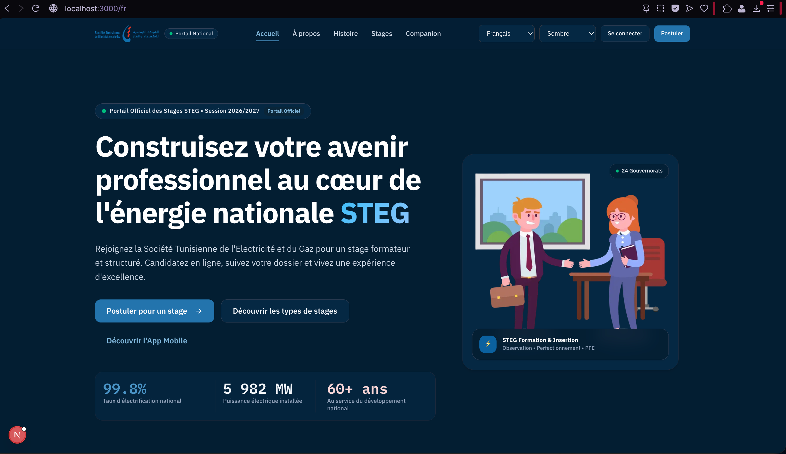
    <strong>French landing page</strong><br>
    <sub>Official portal entry point with a clear call to apply.</sub>
  </a>
  <a href="screenshots/front-office/internship-types-page.png" style="display:inline-block; width:360px; margin-right:16px; vertical-align:top; white-space:normal;">
    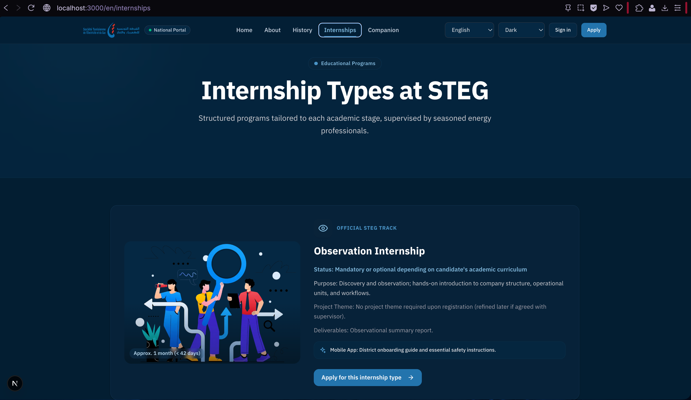
    <strong>Internship types</strong><br>
    <sub>Available programmes and their eligibility context.</sub>
  </a>
  <a href="screenshots/front-office/intern-apply-step1-candidate-info.png" style="display:inline-block; width:360px; margin-right:16px; vertical-align:top; white-space:normal;">
    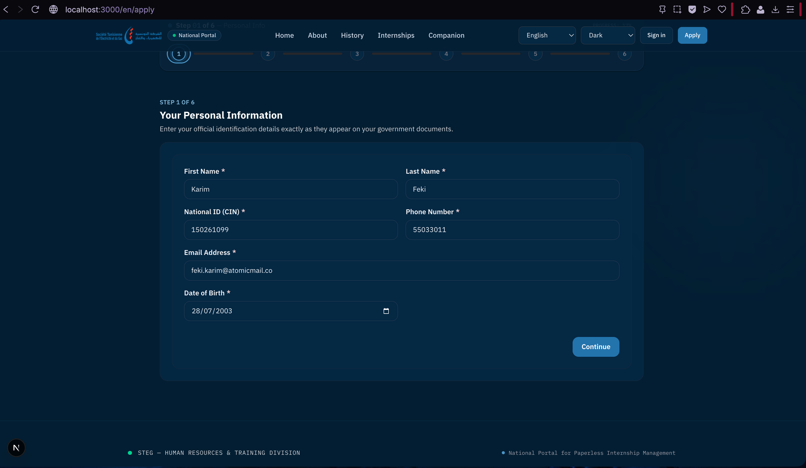
    <strong>Application wizard</strong><br>
    <sub>Step 1 collects the candidate's personal information.</sub>
  </a>
  <a href="screenshots/front-office/intern-apply-step2-education.png" style="display:inline-block; width:360px; margin-right:16px; vertical-align:top; white-space:normal;">
    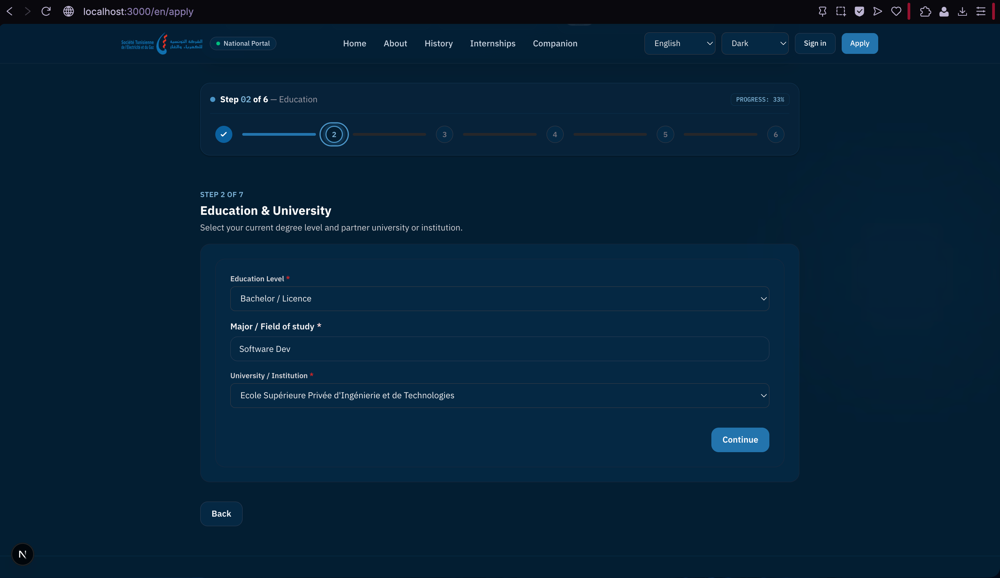
    <strong>Education details</strong><br>
    <sub>Academic level, field of study, and institution selection.</sub>
  </a>
  <a href="screenshots/front-office/ia-validation-document-analyse.png" style="display:inline-block; width:360px; margin-right:16px; vertical-align:top; white-space:normal;">
    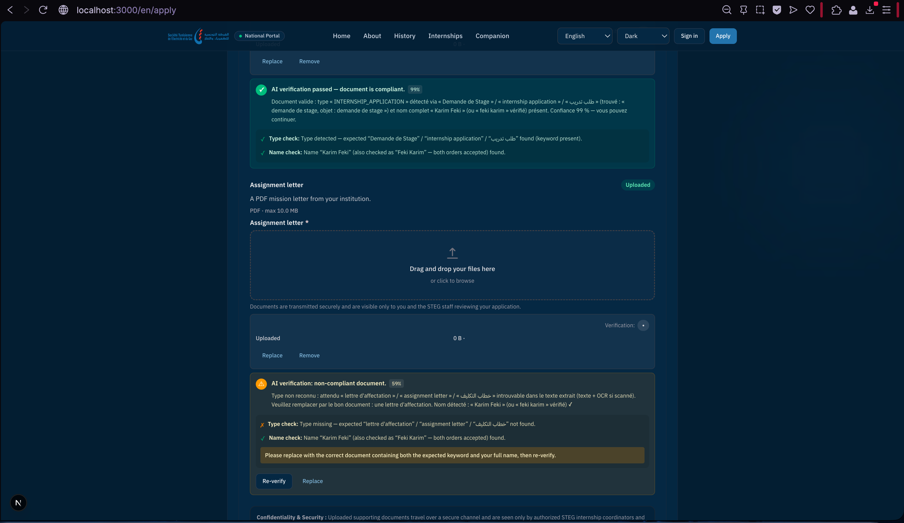
    <strong>Document verification</strong><br>
    <sub>Readable feedback helps the candidate correct a non-compliant document.</sub>
  </a>
  <a href="screenshots/front-office/confirmation-application-info-step6.png" style="display:inline-block; width:360px; margin-right:16px; vertical-align:top; white-space:normal;">
    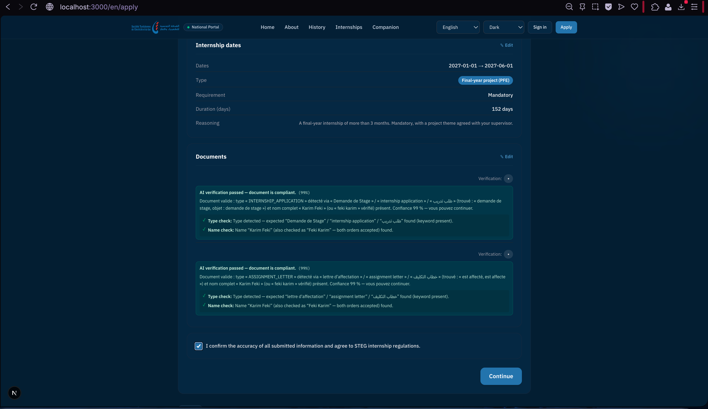
    <strong>Final review</strong><br>
    <sub>Applicants review verified information before submission.</sub>
  </a>
</div>

### 2. Back Office — Review, Coordinate, and Validate

The administrative console centralizes candidate processing, internship assignment, supervision, document review, reporting, and certificate management for STEG teams.

<div style="overflow-x:auto; white-space:nowrap; padding: 8px 0 16px;">
  <a href="screenshots/back-office/admin-dashboard-ar.png" style="display:inline-block; width:520px; margin-right:16px; vertical-align:top; white-space:normal;">
    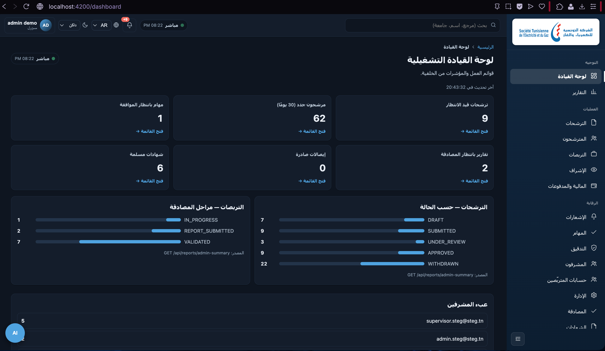
    <strong>Operational dashboard</strong><br>
    <sub>At-a-glance indicators for applications, internships, reports, and pending actions.</sub>
  </a>
  <a href="screenshots/back-office/admin-applications-page.png" style="display:inline-block; width:520px; margin-right:16px; vertical-align:top; white-space:normal;">
    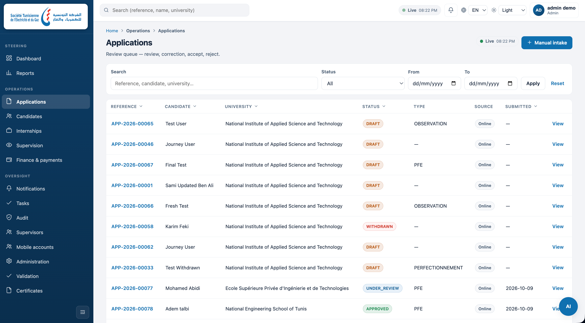
    <strong>Application review queue</strong><br>
    <sub>Search, filter, and process candidate applications by status and internship type.</sub>
  </a>
  <a href="screenshots/back-office/admin-internships-page.png" style="display:inline-block; width:520px; margin-right:16px; vertical-align:top; white-space:normal;">
    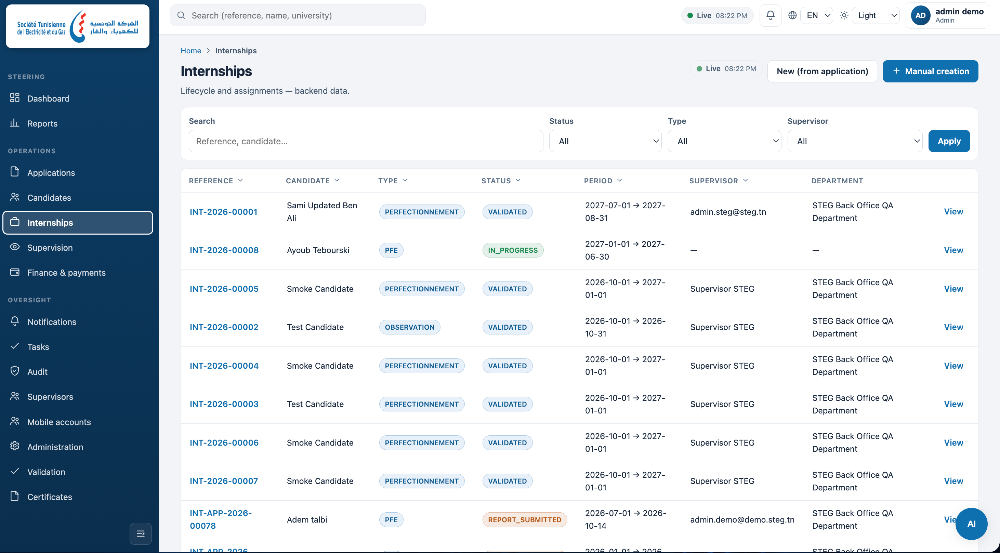
    <strong>Internship lifecycle</strong><br>
    <sub>Follow validated internships, assignments, periods, and departments.</sub>
  </a>
  <a href="screenshots/back-office/admin-supervision-page.png" style="display:inline-block; width:520px; margin-right:16px; vertical-align:top; white-space:normal;">
    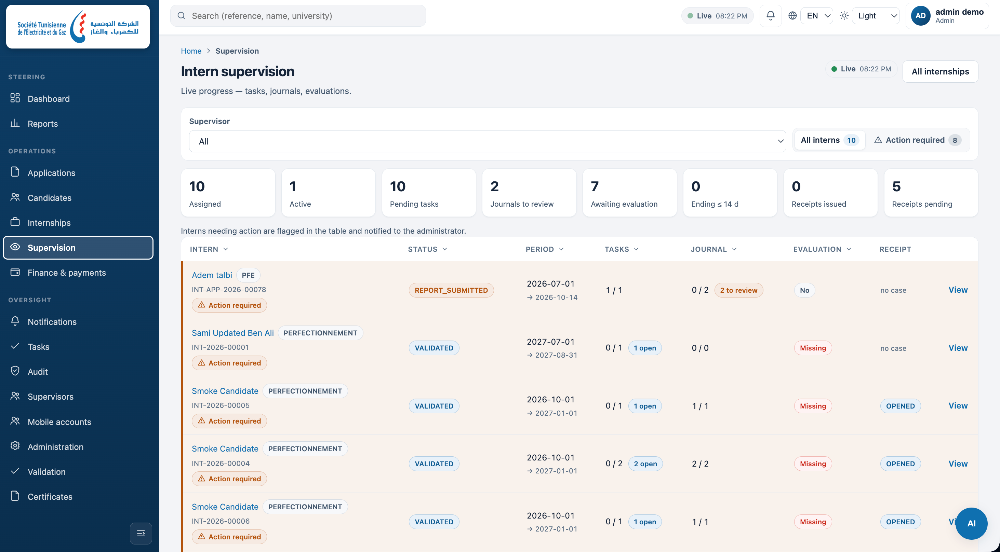
    <strong>Supervision overview</strong><br>
    <sub>Monitor tasks, journals, evaluations, and action-required cases.</sub>
  </a>
  <a href="screenshots/back-office/admin-ia-validation-document-analyse.png" style="display:inline-block; width:520px; margin-right:16px; vertical-align:top; white-space:normal;">
    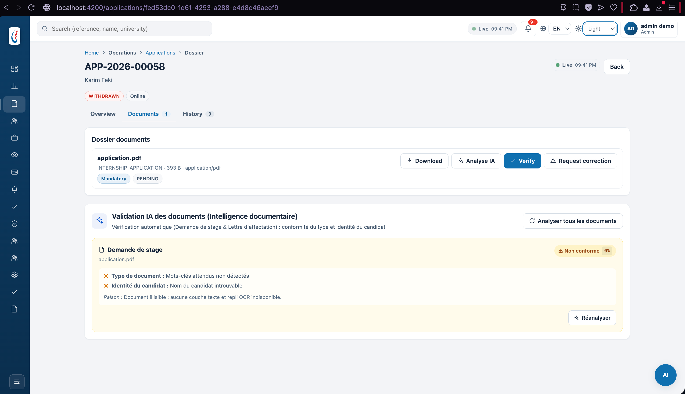
    <strong>Assisted document validation</strong><br>
    <sub>Document checks expose compliance status and explain the reasons for a result.</sub>
  </a>
  <a href="screenshots/back-office/admin-ia-tasks-generator-from-document.png" style="display:inline-block; width:520px; margin-right:16px; vertical-align:top; white-space:normal;">
    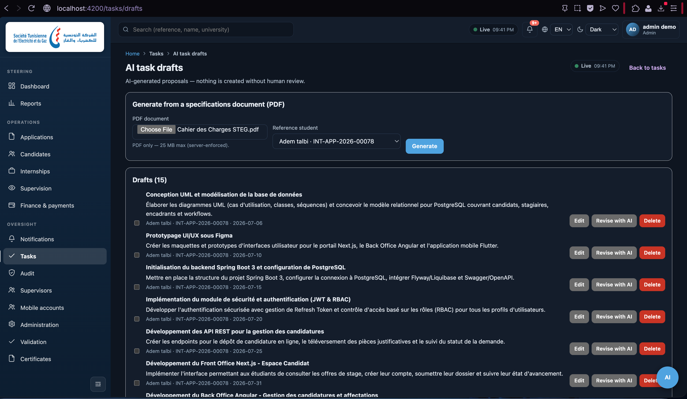
    <strong>AI-assisted task drafting</strong><br>
    <sub>Generate task suggestions from an internship document before human review.</sub>
  </a>
  <a href="screenshots/back-office/admin-certif-preview-page.png" style="display:inline-block; width:520px; margin-right:16px; vertical-align:top; white-space:normal;">
    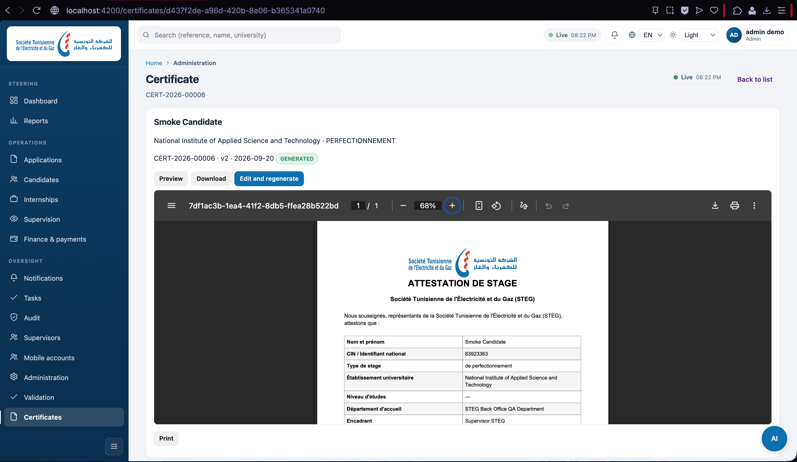
    <strong>Certificate preview</strong><br>
    <sub>Review an official internship certificate before printing or downloading it.</sub>
  </a>
</div>

### 3. Mobile Companion — Track the Internship Day by Day

The Flutter companion app connects interns and supervisors throughout the internship: tasks, progress, messages, documents, community, and contextual assistance are available from one mobile workspace.

<div style="overflow-x:auto; white-space:nowrap; padding: 8px 0 16px;">
  <a href="screenshots/app/stagiaire-home-screen.png" style="display:inline-block; width:220px; margin-right:16px; vertical-align:top; white-space:normal;">
    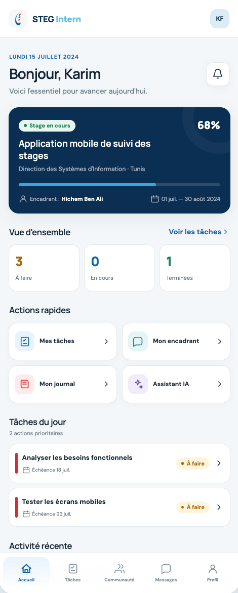
    <strong>Intern dashboard</strong><br>
    <sub>Progress, quick actions, and priority tasks in one view.</sub>
  </a>
  <a href="screenshots/app/stagiaire-mes-taches.png" style="display:inline-block; width:220px; margin-right:16px; vertical-align:top; white-space:normal;">
    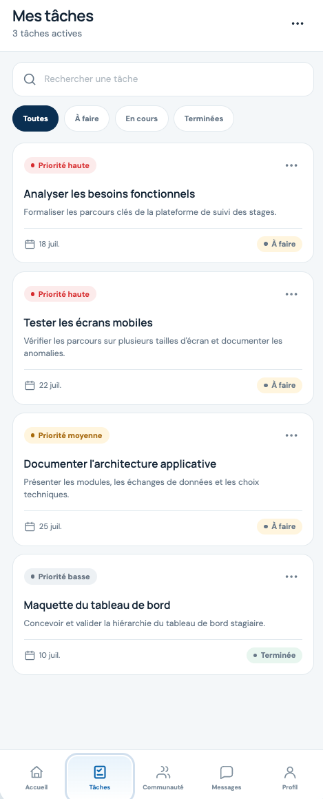
    <strong>Task tracking</strong><br>
    <sub>Priorities, deadlines, and task status for the intern.</sub>
  </a>
  <a href="screenshots/app/stagiaire-ia-chatbot.png" style="display:inline-block; width:220px; margin-right:16px; vertical-align:top; white-space:normal;">
    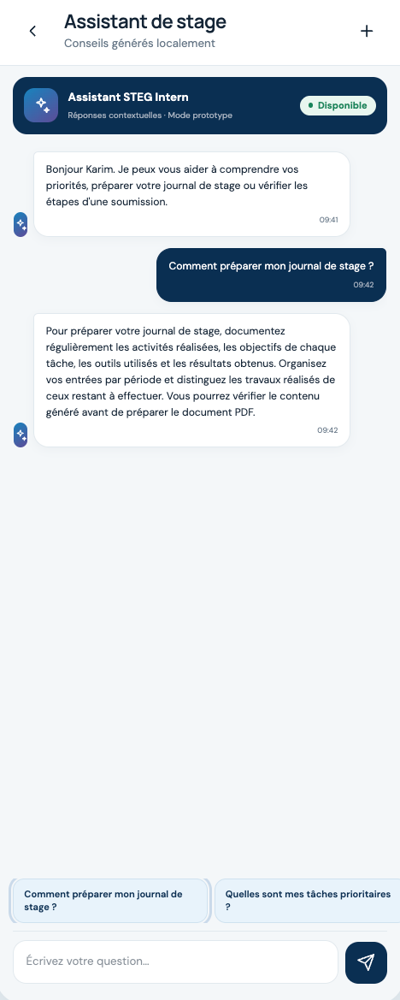
    <strong>Internship assistant</strong><br>
    <sub>Contextual guidance for preparing the internship journal.</sub>
  </a>
  <a href="screenshots/app/stagiaire-message-enc-chat.png" style="display:inline-block; width:220px; margin-right:16px; vertical-align:top; white-space:normal;">
    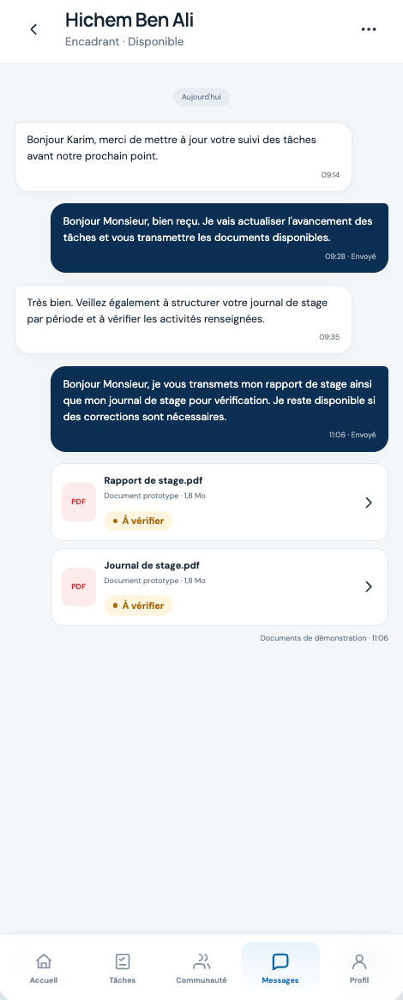
    <strong>Supervisor messaging</strong><br>
    <sub>Direct communication and document exchange with the supervisor.</sub>
  </a>
  <a href="screenshots/app/encadrent-home-screen.png" style="display:inline-block; width:220px; margin-right:16px; vertical-align:top; white-space:normal;">
    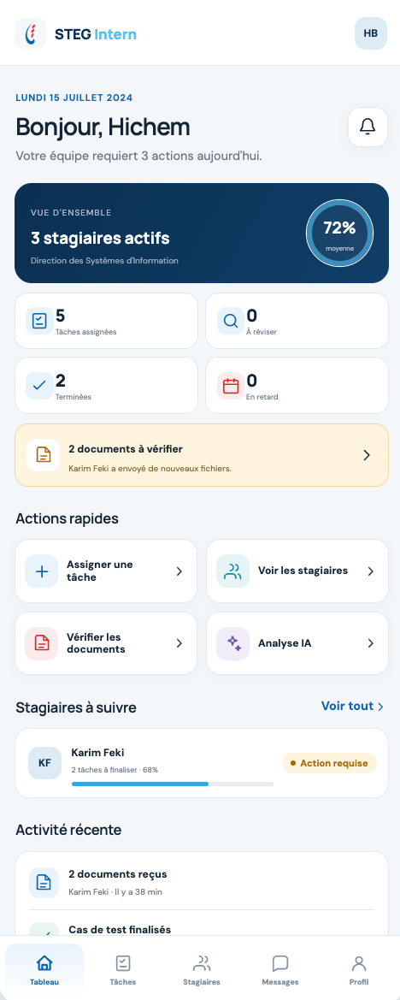
    <strong>Supervisor dashboard</strong><br>
    <sub>Assigned tasks, documents to review, and interns requiring attention.</sub>
  </a>
  <a href="screenshots/app/encadrent-taches.png" style="display:inline-block; width:220px; margin-right:16px; vertical-align:top; white-space:normal;">
    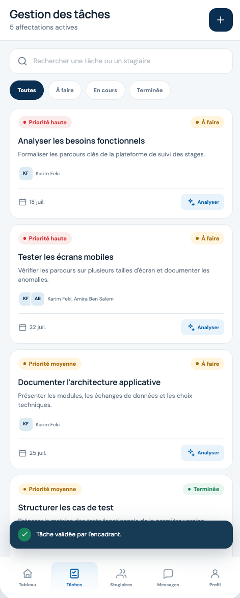
    <strong>Task management</strong><br>
    <sub>Assign, analyse, and validate internship tasks from mobile.</sub>
  </a>
  <a href="screenshots/app/encadrent-verif-docs-ia-result.png" style="display:inline-block; width:220px; margin-right:16px; vertical-align:top; white-space:normal;">
    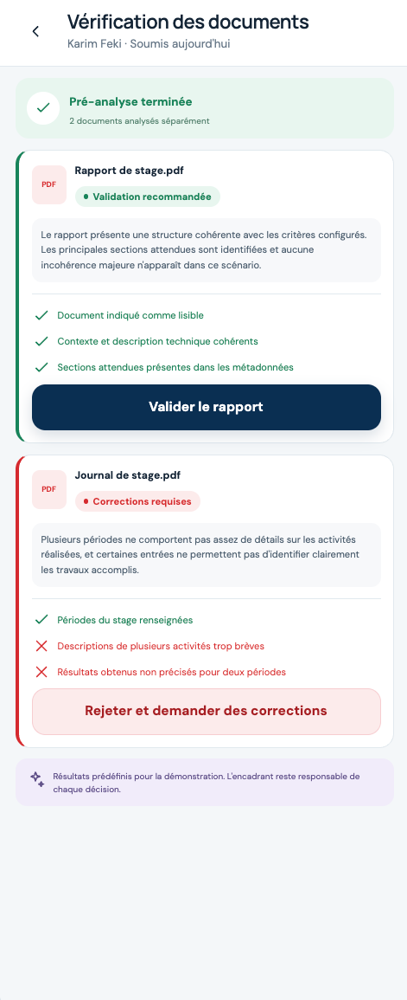
    <strong>Verification result</strong><br>
    <sub>Explainable checks support the supervisor's final decision.</sub>
  </a>
</div>

> **Reading the galleries:** the screenshots are representative product views, not a complete feature inventory. See the subsystem documentation below for implementation details and setup instructions.

---

## 🚀 Quick Start Guide

### Prerequisites
- **Java:** JDK 21+
- **Node.js:** 20.x+ (npm 10+)
- **Python:** 3.11+
- **Flutter:** 3.13+ (Dart 3.3+)
- **PostgreSQL:** 15+

### Running the Full Stack Locally

1. **Start PostgreSQL Database:**
   ```bash
   createdb -U postgres steg_db
   ```

2. **Launch AI Microservice (Port 8000):**
   ```bash
   cd ai-services
   python3 -m venv .venv && source .venv/bin/activate
   pip install -r requirements.txt
   uvicorn app.main:app --port 8000 --reload
   ```

3. **Launch Spring Boot Backend (Port 8080):**
   ```bash
   cd steg-backend
   ./mvnw clean spring-boot:run -Dspring-boot.run.profiles=local
   ```

4. **Launch Front Office (Port 3000):**
   ```bash
   cd steg-front-office
   npm install && npm run dev
   ```

5. **Launch Back Office (Port 4200):**
   ```bash
   cd steg-back-office
   npm install && npm start
   ```

6. **Launch Mobile Companion App:**
   ```bash
   cd stegappe
   flutter pub get && flutter run
   ```

---

## 📚 Detailed Documentation

Comprehensive platform documentation is available in the [`docs/`](docs/) directory:
- [System Architecture Overview](docs/system-architecture.md)
- [Cross-Part Feature Mapping](docs/cross-part-feature-mapping.md)
- [Master API Documentation & Contracts](docs/api-documentation.md)
- [Complete Setup & Installation Guide](docs/setup-and-installation.md)

---

## 📄 License & Confidentiality
Proprietary software developed for the **Société Tunisienne de l'Électricité et du Gaz (STEG)**. All rights reserved.
