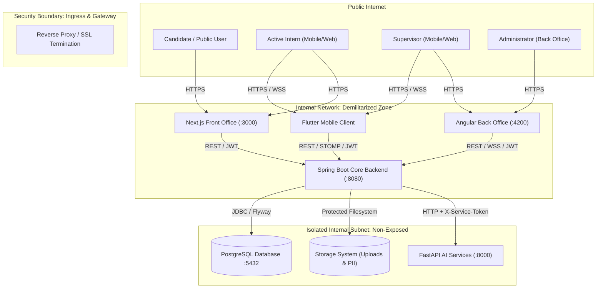
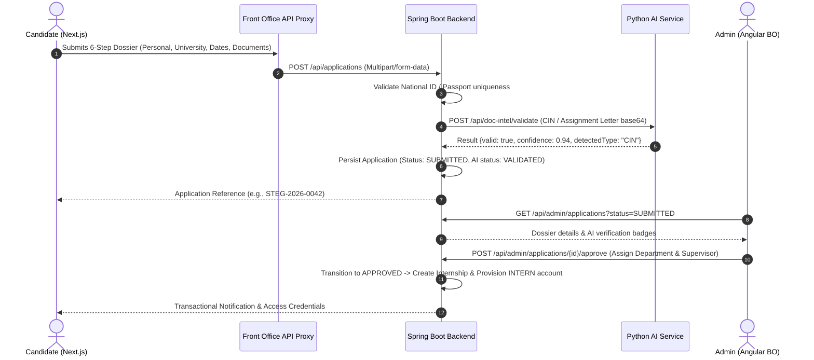
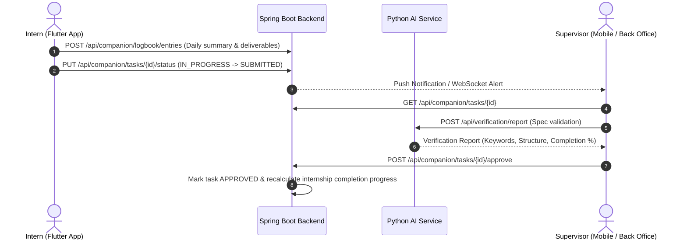
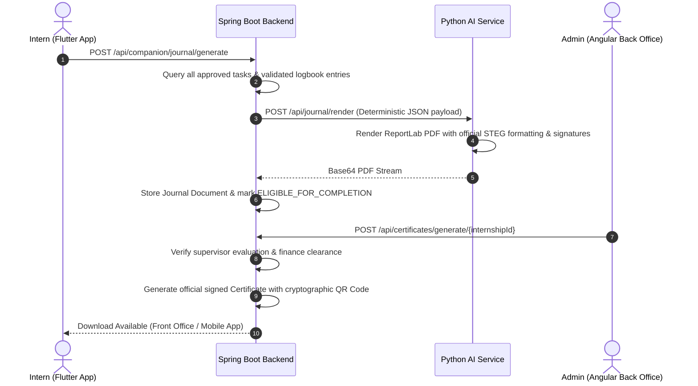

# System Architecture Overview

## 1. Executive Summary

The **STEG Smart Internship & Administrative Workflow Platform** is an enterprise-grade digital solution designed for the **Société Tunisienne de l'Électricité et du Gaz (STEG)**. It modernizes the entire lifecycle of student internships across Tunisia—from public application intake, identity verification, and multi-tier administrative review, to day-to-day internship tracking, task supervision, AI-assisted document validation, logbook journal compilation, evaluations, stipend payment tracking, and certificate issuance.

The platform unifies 5 core components into a cohesive, secure, and distributed ecosystem:

```
                                  +---------------------------------------+
                                  |       Public Candidates & Interns     |
                                  |         (Next.js Front Office)        |
                                  |         Web Browser (Desktop/Mobile)  |
                                  +-------------------+-------------------+
                                                      |
                                                      | HTTPS / REST / WS
                                                      v
+-------------------------------+  HTTPS / REST / WS  +---------------------------------------+  Private HTTP (Token)  +-------------------------------+
|      STEG Mobile Companion    | ------------------> |              STEG Backend             | ---------------------> |      Python AI Services       |
|            (Flutter)          |                     |             (Spring Boot)             |                        |           (FastAPI)           |
|    Interns & Supervisors      |                     |   Port: 8080 (REST + STOMP WebSocket) |                        |    Port: 8000 (Internal Only) |
+-------------------------------+                     +-------------------+-------------------+                        +-------------------------------+
                                                      ^                   |
                                                      |                   | PostgreSQL / Flyway
                                                      | HTTPS / REST / WS v
                                  +-------------------+-------------------+
                                  |          STEG Back Office             |
                                  |              (Angular)                |
                                  |        Admins & Supervisors           |
                                  +---------------------------------------+
```

---

## 2. High-Level Subsystem Topology

| Subsystem | Technology Stack | Primary Audience | Operational Scope |
| :--- | :--- | :--- | :--- |
| **`steg-backend`** | Java 21, Spring Boot 4.1.1, Spring Security, Spring Data JPA, Flyway, PostgreSQL, STOMP WebSocket | Platform Core | Central source of truth. Handles business workflows, RBAC/ABAC authorization, audit logging, STOMP messaging, document storage, and notification dispatch. |
| **`ai-services`** | Python 3.11+, FastAPI, Pydantic, PyMuPDF, ReportLab, Tesseract OCR | Internal Backend Only | Sandboxed microservice for deterministic & heuristic document parsing, CIN/assignment letter validation, report analysis, finance verification, and PDF journal generation. |
| **`steg-front-office`** | Next.js 16.3 (React 19), TypeScript, Tailwind CSS, `next-intl` | Candidates & Interns | Public portal for browsing internship catalogs, 6-step application submission, application tracking, profile management, and document uploads. |
| **`steg-back-office`** | Angular 22.1, TypeScript, Tailwind CSS, RxJS, NgRx Signals | Admins & Supervisors | Administrative portal featuring dossier queues, document approvals, supervisor assignment, task management, finance/stipend review, audit logs, and certificates. |
| **`stegappe`** | Flutter 3.13+, Dart, Flutter Riverpod, `flutter_secure_storage` | Interns & Field Supervisors | Native Android & iOS mobile app providing real-time chat, task boards, AI companion suggestions, daily logbooks, supervisor validations, evaluations, and community feed. |

---

## 3. Communication Protocols & Security Boundaries



### 3.1 Network Isolation Rules
1. **`ai-services` is strictly internal:** Browsers and mobile clients never invoke FastAPI endpoints directly. Every call to `/api/*` on `ai-services` requires the `X-Service-Token` header.
2. **Spring Boot is the single domain authority:** All business rules, access control checks (RBAC/ABAC), state transitions, database writes, and audit entries are executed exclusively within `steg-backend`.
3. **Database and File Storage:** Direct access to PostgreSQL and the underlying physical storage (`storage/uploads`) is restricted exclusively to the Spring Boot application container.

---

## 4. Cross-System Architectural Decisions (ADRs)

### 4.1 Authentication & Token Rotation Model
- **Access Tokens:** Standard JWT tokens signed with HMAC-SHA256, carrying user ID, role, and fine-grained permissions (15-minute default expiration).
- **Refresh Tokens:** High-entropy opaque UUID strings stored in the database, bound to client IP and User-Agent, with automatic one-time rotation upon every invocation (`POST /api/auth/refresh`).
- **Account Lockout:** Enforced on `steg-backend`—5 consecutive invalid password attempts lock the account for 30 minutes.

### 4.2 Role-Based and Attribute-Based Access Control (RBAC / ABAC)
The platform establishes 4 canonical system roles:
- `CANDIDATE`: Registered prospective intern. Restricted to viewing their own applications and draft submissions.
- `INTERN`: Approved candidate whose internship has commenced. Has access to the companion workspace, logbook entries, task progress, STOMP messaging, and community channels.
- `SUPERVISOR`: STEG staff engineer/mentor. Authorized to oversee assigned interns, validate deliverables, rate evaluations, review stipend requests, and manage task drafts.
- `ADMIN`: STEG central administration. Full administrative authority over users, supervisors, applications, internships, finance records, certificates, and system audit logs.

*Fine-grained permission:* `DOCUMENT_VIEW_RESTRICTED` is required to stream or download identity documents (CIN, sensitive academic records), audited with client IP and user metadata prior to streaming.

### 4.3 Real-Time Architecture (STOMP over WebSocket)
- **Broker Endpoint:** `/ws` with SockJS fallback.
- **Security:** Authenticated via `JwtHandshakeInterceptor` and `StompAuthChannelInterceptor`.
- **Topologies:**
  - Topic Subscriptions: `/topic/conversations/{conversationId}`, `/topic/community`
  - User-Scoped Queues: `/user/queue/notifications`, `/user/queue/messages`
- Clients (`stegappe`, `steg-front-office`, `steg-back-office`) leverage resilient client libraries (`@stomp/stompjs` and Dart `stomp_dart_client`) with automatic reconnect backoff and offline reconciliation.

---

## 5. End-to-End Core Data Workflows

### Workflow 1: Public Intake to Internship Assignment


### Workflow 2: Daily Internship Tracking & Task Verification


### Workflow 3: Completion, Journal Generation & Certificate Issuance


